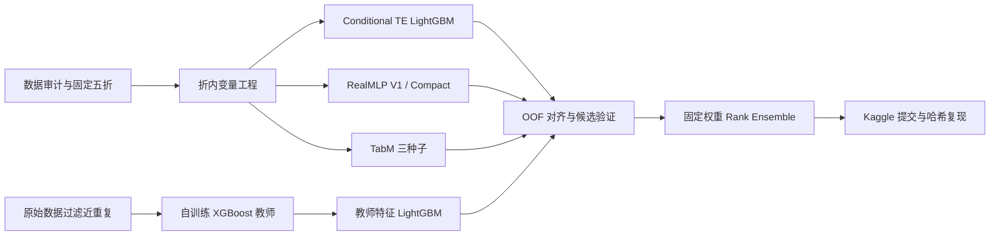

# Airline Satisfaction Prediction

**Kaggle Playground Series S6E10 | Public ROC-AUC 0.96114 | 自训练表格模型集成**

面向约 70 万条航空乘客记录，构建从数据审计、交叉拟合变量工程到异构模型融合的完整分类流程。最终使用 LightGBM、RealMLP 和 TabM 的五条训练配置，将自训练方案的 Public AUC 从 0.96099 提升至 **0.96114**。所有参与融合的预测均来自本地自主训练；公开方案仅用于方法学习。

## 项目价值

- **变量工程与验证相结合**：使用条件目标编码、频次统计、数值与类别双重表示及路线统计；将带标签编码放入折内交叉拟合流程，减少目标泄漏。
- **利用相关原始数据**：在公开原始航空数据上自行训练 XGBoost 教师，过滤预定义近重复样本，再将教师分数作为 LightGBM 特征。
- **按互补性选择模型**：同时考察单模型 AUC 和加入融合后的分折增益，最终引入精简特征 RealMLP，而不是仅增加模型数量。
- **可核验的交付**：保留代码、压缩数据、OOF/test 预测、已保存权重、实验日志和线上截图；支持提交文件逐字节复现。

## 数据与任务

| 项目 | 内容 |
|---|---|
| 目标 | 预测乘客满意度标签 satisfaction，二分类 |
| 训练 / 测试样本 | 699,635 / 299,844 |
| 原始输入 | 21 个特征，含服务评分、出行类别、年龄、航程及延迟 |
| 类别分布 | 训练集正例约 44.36% |
| 缺失 | Arrival Delay in Minutes：训练 292 条、测试 130 条 |
| 评价指标 | ROC-AUC，关注排序能力；不是分类准确率 |

本项目是竞赛批量预测实验，没有宣称实际航空业务部署、收入提升或榜单百分位。

## 方法流程



Compact RealMLP 使用 47 个输入特征和固定 3 epochs：保留原始数值、数值类别副本、折内频次、三组交互 TE；去掉其中两组高基数交互的直接类别表示。其单模型 OOF 为 0.961172，加入原自训练融合后，五折诊断增益均为正。

## 结果

| 方案 | 本地 OOF AUC | Public AUC |
|---|---:|---:|
| 早期自训练最佳线上方案 | 配置不完全对应，不作配对比较 | 0.96099 |
| 加入自训练教师特征的融合 | 0.961451589 | 0.96105 |
| 最终五配置融合 | **0.961495167** | **0.96114** |

最终权重为：Conditional TE LightGBM **15.68%**、RealMLP V1 **23.52%**、三种子 TabM **9.80%**、教师 LightGBM **21.00%**、Compact RealMLP **30.00%**。各分量分别取标准化秩后加权；TabM 先做种子概率平均。三种模型族、五条配置、七组种子训练结果，每组采用五折；原始数据教师另计。


## 关键实验与判断

| 尝试 | 观察 | 决策 |
|---|---|---|
| 原始数据教师特征 | 改善原自训练融合，Public 达 0.96105 | 保留 |
| Compact RealMLP + 九种固定融合候选 | 最终 OOF 0.961495，五折增益均正，Public 0.96114 | 保留 |
| Extra Trees LightGBM | 两折增益不一致 | 停止扩展，保留审计记录 |
| 本轮增强 LGBM / XGBoost | 两折筛选未提供稳定增益 | 不加入最终模型 |
| 更稀疏的三 / 四配置组合 | 没有同时获得更好且稳定的验证结果 | 保留当前五配置 |

候选在历史折 1/2 上选择，折 3/4/5 作诊断确认。这些 OOF 被多轮复用，**并非完全独立的最终留出评估或完整嵌套 CV**；历史 LGBM 也使用外层验证折早停。部分历史无监督处理使用了测试协变量，属于竞赛批处理设定。Public 结果不能代表未来 Private 分数或生产效果。

## 复现与阅读入口

```sh
pip install -r requirements-reproduce.txt
python src/unpack_artifacts.py
python reproduce.py
```

输出提交与实际上传文件逐字节一致，SHA-256：`9700c827f0dd1b8d46098b19c9c3de83c123fb6de96d5342b76f98628c3308ca`。

| 内容 | 入口 |
|---|---|
| 完整复现、重训与环境说明 | [REPRODUCIBILITY.md](REPRODUCIBILITY.md) |
| 固定权重与最终成绩 | [ensemble_spec.json](ensemble_spec.json) |
| 原始数据压缩包 | data/，运行 src/unpack_data.py 解压 |
| 预测、权重、实验记录 | artifacts/，运行 src/unpack_artifacts.py 解压 |
| 完整性校验 | MANIFEST.json、archive_validation.json |

## 参考与边界

方法学习参考 [路线与距离特征](https://www.kaggle.com/code/busyaprime/s6e10-route-or-distance-both-lb-0-96169)、[RealMLP 配置](https://www.kaggle.com/code/yekenot/ps-s6-e10-realmlp-pytabkit)、[教师特征](https://www.kaggle.com/code/sachith7/s6e10-what-each-step-was-worth)。原始数据来自 [Airline Satisfaction 129K](https://www.kaggle.com/datasets/arseniyshutko/binary-aviation-satisfaction-129k)。TabM 的准确含义见其[官方仓库](https://github.com/yandex-research/tabm)：它是基于 MLP 的参数高效集成模型。

项目没有使用其他参赛者的 OOF/test 预测或已训练模型。神经网络保留了训练源码与预测，部分网络权重未序列化；不能声称所有模型都可直接加载推理。数据及第三方方法遵循原来源条款。
