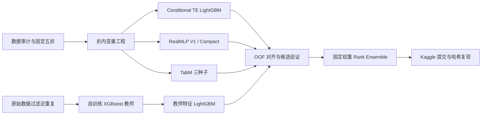
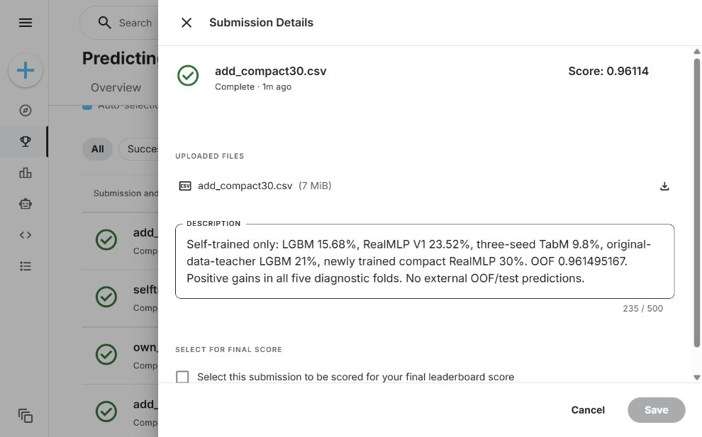

# Airline Satisfaction Prediction

**Kaggle Playground Series S6E10 · 特征工程与异构模型集成 · Public ROC-AUC 0.96114**

这是我的航空乘客满意度预测项目。围绕约 70 万条训练样本，我将数据审计、交叉拟合特征工程、模型训练与融合评估组织成完整的实验流程，重点研究如何构建有效的统计特征，以及如何判断新模型对现有组合的增量价值。

最终方案融合 LightGBM、RealMLP 和 TabM 的五条训练配置，Public ROC-AUC 从 **0.96099** 提升至 **0.96114**，对应最终配置的本地 OOF AUC 为 **0.961495167**。所有融合分量均由项目内的训练流程生成，源码、数据、预测和实验记录可在仓库中追溯。

## 核心工作

- **变量工程与验证相结合**：使用条件目标编码、频次统计、数值与类别双重表示及路线统计；将带标签编码放入折内交叉拟合流程，减少目标泄漏。
- **利用相关原始数据**：在公开原始航空数据上自行训练 XGBoost 教师，过滤预定义近重复样本，再将教师分数作为 LightGBM 特征。
- **按互补性选择模型**：联合考察单模型 AUC、OOF 预测相关性和融合后的分折增益，比较概率、logit、秩及逻辑回归融合方案，最终选用固定权重 Rank Ensemble。
- **精简神经网络输入表示**：保留三组交互 TE，移除两组高基数交互的直接类别输入，形成 47 列 Compact RealMLP 配置，获得稳定的融合增益。
- **建立可复现的实验流程**：保存训练源码、依赖环境、OOF/test 预测、已序列化权重和实验日志，通过 SHA-256 校验逐字节重建最终提交。

## 数据与任务

| 项目 | 内容 |
|---|---|
| 目标 | 预测乘客满意度标签 satisfaction，二分类 |
| 训练 / 测试样本 | 699,635 / 299,844 |
| 原始输入 | 21 个特征，含服务评分、出行类别、年龄、航程及延迟 |
| 类别分布 | 训练集正例约 44.36% |
| 缺失 | Arrival Delay in Minutes：训练 292 条、测试 130 条 |
| 评价指标 | ROC-AUC，衡量正负样本的排序区分能力 |

数据审计结果见 [data_audit.json](data_audit.json)。

## 技术路线



### 特征工程

条件 TE 将类别目标统计放入乘客细分情境中，例如结合舱位、出行类型、性别或年龄计算群体满意度。外层五折用于生成 OOF 预测，训练折内部再交叉拟合带标签编码，使训练样本的编码不直接使用自身标签。

Compact RealMLP 的 47 列输入包括 21 个原始特征、17 个数值类别副本、1 个直接交互类别、5 个计数特征和 3 个交互 TE。类别词表与计数从训练折拟合；网络使用 512/256/128 隐藏层、8 个内部集成成员和固定 3 epochs。单模型 OOF 为 0.961172，加入融合后的五折诊断增益均为正。实现见 [train_realmlp_compact.py](src/train_realmlp_compact.py)。

教师特征来自相关的原始航空数据：129,880 行中排除 465 个预定义近重复样本后，训练 XGBoost 并生成比赛样本的 logit 特征。过滤规则使用特征相似性，不使用比赛标签；教师的作用通过下游 LightGBM 体现。

## 结果

| 方案 | 本地 OOF AUC | Public AUC |
|---|---:|---:|
| 早期自训练最佳线上方案 | 配置不完全对应，不作配对比较 | 0.96099 |
| 加入自训练教师特征的融合 | 0.961451589 | 0.96105 |
| 最终五配置融合 | **0.961495167** | **0.96114** |

最终权重为：Conditional TE LightGBM **15.68%**、RealMLP V1 **23.52%**、三种子 TabM **9.80%**、教师 LightGBM **21.00%**、Compact RealMLP **30.00%**。各分量分别取标准化秩后加权；TabM 先做种子概率平均。三种模型族、五条配置、七组种子训练结果，每组采用五折；原始数据教师另计。



## 关键实验与判断

| 尝试 | 观察 | 决策 |
|---|---|---|
| 原始数据教师特征 | 改善原自训练融合，Public 达 0.96105 | 保留 |
| Compact RealMLP + 九种固定融合候选 | 最终 OOF 0.961495，五折增益均正，Public 0.96114 | 保留 |
| Extra Trees LightGBM | 两折增益不一致 | 停止扩展，保留审计记录 |
| 增强特征 LGBM / XGBoost | 两折筛选未提供稳定增益 | 不加入最终模型 |
| 更稀疏的三 / 四配置组合 | 没有同时获得更好且稳定的验证结果 | 保留当前五配置 |

我的模型选择标准是**加入组合后的稳定增益**。单模型分数较高并不自动意味着融合收益更大；输入表示、归纳偏好和错误相关性共同影响最终效果。

### 验证范围

候选在历史折 1/2 上选择，折 3/4/5 作诊断确认。这些 OOF 被多轮复用，**并非完全独立的最终留出评估或完整嵌套 CV**；历史 LGBM 也使用外层验证折早停。部分历史无监督处理使用了测试协变量，属于竞赛批处理设定。Public 结果不能代表未来 Private 分数或生产效果。

## 快速复现与仓库结构

```sh
pip install -r requirements-reproduce.txt
python src/unpack_artifacts.py
python reproduce.py
```

输出提交与实际上传文件逐字节一致，SHA-256：`9700c827f0dd1b8d46098b19c9c3de83c123fb6de96d5342b76f98628c3308ca`。

| 内容 | 入口 |
|---|---|
| 完整复现、重训与环境说明 | [REPRODUCIBILITY.md](REPRODUCIBILITY.md) |
| 固定权重与最终成绩 | [ensemble_spec.json](ensemble_spec.json) |
| 原始数据压缩包 | data/，运行 src/unpack_data.py 解压 |
| 预测、权重、实验记录 | artifacts/，运行 src/unpack_artifacts.py 解压 |
| 完整性校验 | MANIFEST.json、archive_validation.json |

神经网络训练源码与预测已保留，部分网络权重未序列化；精确复现基于冻结预测，GPU 完整重训可能存在数值差异。

## 数据与方法参考

方法学习参考 [路线与距离特征](https://www.kaggle.com/code/busyaprime/s6e10-route-or-distance-both-lb-0-96169)、[RealMLP 配置](https://www.kaggle.com/code/yekenot/ps-s6-e10-realmlp-pytabkit)、[教师特征](https://www.kaggle.com/code/sachith7/s6e10-what-each-step-was-worth)。原始数据来自 [Airline Satisfaction 129K](https://www.kaggle.com/datasets/arseniyshutko/binary-aviation-satisfaction-129k)。TabM 的准确含义见其[官方仓库](https://github.com/yandex-research/tabm)：它是基于 MLP 的参数高效集成模型。

参考资料用于方法研究；最终融合使用本项目训练生成的预测。数据及第三方方法遵循原来源条款。
